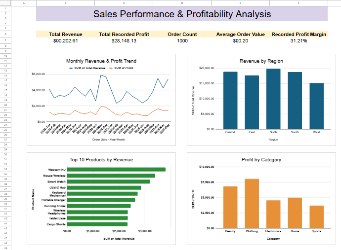

# Sales Performance & Profitability Analysis

A data analysis and business reporting project built with Google Sheets to evaluate e-commerce sales, recorded profit, product performance, and business trends.

## Project Overview

This project analyzes 1,000 e-commerce orders to identify sales patterns, compare regional and category performance, evaluate products, and summarize key business metrics in a dashboard.

## Objectives

- Evaluate overall sales and profitability.
- Compare performance across regions and product categories.
- Identify top-performing products by revenue.
- Analyze monthly revenue and recorded profit.
- Present key findings and business recommendations.

## Tools & Techniques

- **Google Sheets**
- Spreadsheet formulas and data validation checks
- Revenue consistency and discount checks
- Pivot Tables
- KPI calculations
- Data visualization and dashboard design
- Business insights and recommendations

## Dashboard

The dashboard presents five key performance indicators and four charts covering monthly trends, regional revenue, top products, and category profit.

### Dashboard Preview

### Business Insights Preview

**Key Performance Indicators**

| Metric | Result |
|---|---:|
| Total Revenue | $90,202.61 |
| Total Recorded Profit | $28,148.13 |
| Number of Orders | 1,000 |
| Average Order Value | $90.20 |
| Recorded Profit Margin | 31.21% |

## Key Findings

- **Regional performance:** South recorded the highest revenue at $20,416.38, while North recorded the highest profit at $6,680.41.
- **Category performance:** Electronics generated the highest revenue at $27,669.23. Clothing recorded the highest profit at $8,051.40.
- **Product performance:** Webcam HD generated the highest revenue among the analyzed products at $3,794.02.
- **Monthly trends:** Revenue peaked at $5,919.13 in November 2024 and reached its lowest point of $2,342.26 in February 2025.

## Workbook Structure

- **Dashboard:** KPIs and visual summaries.
- **Business Insights:** Findings and business recommendations.
- **Pivot Analysis:** Detailed performance summaries.
- **Calculations:** Formula-based consistency checks and calculated metrics.
- **Raw Data:** Source dataset used for the analysis.

## Deliverables

- Google Sheets analysis workbook
- KPI dashboard with four charts
- Pivot Table analysis
- Business insights and recommendations

## Project Access

[View the Google Sheets Project](https://docs.google.com/spreadsheets/d/1pEwvmxaxegZeI6uVDW9axO8L3eguGGzPzoeejy1n1Rc/edit?usp=sharing)

## Data Source

Sample e-commerce data based on the dataset resources provided by Trump Excel:  
https://trumpexcel.com/excel-sample-data/

**Dataset Note:** This project uses sample e-commerce data for portfolio and analytical practice purposes. The findings reflect the provided dataset and should not be interpreted as results from a real business.

## Freelance Services

I offer project-based services in data analysis, sales and profitability reporting, and Google Sheets dashboard development.

Projects are completed for an agreed fixed fee, with clearly defined deliverables and deadlines. Communication is asynchronous through written messages or email, with responses provided as promptly as reasonably possible.

For freelance project inquiries, please contact me through [LinkedIn](https://www.linkedin.com/in/sahel-g-5a619a1bb/?isSelfProfile=true).
